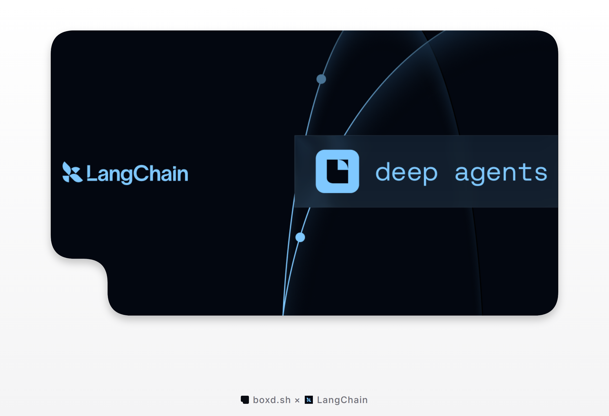

# langchain-boxd

[boxd](https://boxd.sh?ref=langchain-boxd) sandbox integration for
[Deep Agents](https://github.com/langchain-ai/deepagents). Because Deep Agents
compiles to a LangGraph graph, this works across LangChain, LangGraph and Deep
Agents.

A boxd machine is a full Ubuntu 24.04 VM (KVM microVM) with a persistent disk.
It boots in about a second, and can be hibernated, snapshotted and forked.
`BoxdSandbox` runs the agent's shell commands and file operations inside one.

## Install

```bash
pip install langchain-boxd
# or: uv add langchain-boxd
```

Create an API key at [app.boxd.sh/keys](https://app.boxd.sh/keys?ref=langchain-boxd)
and export it:

```bash
export BOXD_API_KEY="bxd_..."
```

Inside a boxd machine you can skip the key: the SDK uses the machine's own
credential.

## Quick start

`BoxdSandbox.create()` makes a new machine and waits until it takes commands.
Used as a context manager, it deletes the machine when the block ends.
`delete_after` is a safety net: boxd deletes the machine after that many
seconds even if your process dies first.

```python
from langchain_boxd import BoxdSandbox

with BoxdSandbox.create(delete_after=3600) as backend:
    result = backend.execute("python3 --version")
    print(result.output)
```

## Use with Deep Agents

```python
from deepagents import create_deep_agent
from langchain_anthropic import ChatAnthropic

from langchain_boxd import BoxdSandbox

with BoxdSandbox.create(delete_after=3600) as backend:
    agent = create_deep_agent(
        model=ChatAnthropic(model="claude-sonnet-5-5"),
        system_prompt="You are a coding assistant with a Linux sandbox. Work in /home/boxd.",
        backend=backend,
    )
    result = agent.invoke(
        {
            "messages": [
                {
                    "role": "user",
                    "content": "Write hello.py that prints hello, run it and show me the output.",
                }
            ]
        }
    )
    print(result["messages"][-1].text)
```

## Use a machine you already have

Pass a `boxd.Boxd` client and a machine id (or name). The backend never deletes
a machine it did not create, so the machine and its disk outlive the agent
run. Hibernate it between runs to stop paying for memory and CPU.

```python
from boxd import Boxd

from langchain_boxd import BoxdSandbox

client = Boxd()  # reads BOXD_API_KEY
machine = client.machines.create(labels={"app": "agent"})
client.machines.wait_until_ready(machine.id)

backend = BoxdSandbox(client=client, machine_id=machine.id)
backend.write("/home/boxd/notes.md", "# notes\n")
print(backend.execute("ls -l /home/boxd").output)

client.machines.hibernate(machine.id)  # sleep, keep the disk
client.machines.delete(machine.id)  # or delete it for good
```

## Deep Agents Code

Installing this package registers a `boxd` sandbox provider for the
`deepagents-code` (`dcode`) terminal agent:

```bash
dcode install langchain-boxd --package
export BOXD_API_KEY="bxd_..."
dcode --sandbox boxd
```

`dcode --sandbox boxd --sandbox-id <machine>` reattaches to a machine and wakes
it if it is stopped, suspended or hibernated. `--sandbox-snapshot-name <name>`
restores a boxd snapshot instead of booting the default image.

| Setting | Default | Purpose |
| --- | --- | --- |
| `BOXD_API_KEY` (or `DEEPAGENTS_CODE_BOXD_API_KEY`) | none | API key |
| `BOXD_REGION` (or `DEEPAGENTS_CODE_BOXD_REGION`) | boxd's default | region to create machines in |
| `BOXD_IMAGE` | the boxd image | image for new machines |
| `BOXD_DELETE_AFTER` | never | seconds until boxd deletes a new machine |

`name`, `labels`, `image`, `delete_after`, `workdir` and `command_timeout` can
also be set as provider params in `~/.deepagents/config.toml`. A config entry
replaces what the package registers, so it repeats the provider's
`class_path` and capabilities next to its params:

```toml
[sandboxes.providers.boxd]
class_path = "langchain_boxd.provider:BoxdProvider"
working_dir = "/home/boxd"
package = "langchain-boxd"
supports_snapshot_name = true

[sandboxes.providers.boxd.params]
labels = { team = "ai" }
delete_after = 86400
```

`dcode` deletes a machine it created when it shuts down cleanly. Set
`delete_after` anyway: a `dcode -n` run can exit before its cleanup runs (it
did in testing with deepagents-code 0.1.88), and boxd then still deletes the
machine on time.

## What you get

`BoxdSandbox` subclasses `deepagents.backends.sandbox.BaseSandbox`, so it
implements the full `SandboxBackendProtocol`:

| Method | Backed by |
| --- | --- |
| `execute()` | `client.machines.exec`, run as `bash -c '<command>'` in `/home/boxd` |
| `upload_files()` / `download_files()` | `client.machines.fs.write` / `client.machines.fs.read` |
| `ls` / `read` / `write` / `edit` / `glob` / `grep` / `delete` | inherited from `BaseSandbox` |
| `id` | the boxd machine id |

Async variants (`aexecute`, `aupload_files`, ...) come from the base class,
which runs the sync methods in a thread.

### Options

| Argument | Default | Purpose |
| --- | --- | --- |
| `machine_id` | required | machine id or name (`BoxdSandbox(...)` only) |
| `client` | `Boxd()` | boxd client; reads `BOXD_API_KEY` and `BOXD_REGION` |
| `workdir` | `/home/boxd` | directory commands run in |
| `timeout` | `1800` | default command timeout in seconds; `0` waits forever |
| `shell` | `bash` | shell each command runs under; `None` uses the machine's `/bin/sh` |
| `region` | client's region | region the machine lives in |

`BoxdSandbox.create()` also takes `name`, `image`, `from_snapshot`, `labels`,
`delete_after`, `ready_timeout`, and passes anything else (`vcpu`, `memory`,
`env`, `org`, `isolated`, `networks`, `spec`, ...) to `client.machines.create`.

### Good to know

- Commands run as the `boxd` user, who has passwordless `sudo`. The default
  image has Python 3, git, Node, Docker, ripgrep and more, so the inherited
  file tools (which shell out to `python3`) work out of the box. On your own
  image, make sure it has `bash` and `python3`, or pass `shell=None`.
- Everything else boxd offers (snapshots, forks, egress allowlists, secrets,
  ports and HTTPS URLs) is on `backend.client`, the plain boxd SDK client.

## Examples

Each one runs against real boxd. They read the model from `LC_MODEL`
(default `anthropic:claude-sonnet-5-5`; any LangChain chat model works, for
example `google_genai:gemini-3.8-flash`).

- [`examples/quickstart.py`](examples/quickstart.py): a Deep Agent writes and
  runs code on a fresh machine, which is deleted afterwards.
- [`examples/persistent_workspace.py`](examples/persistent_workspace.py): a
  named machine the agent comes back to. Each run ends by hibernating it, and
  the next run wakes it with its files intact.
- [`examples/parallel_forks.py`](examples/parallel_forks.py): set a project up
  once, fork the machine, and let two agents try two approaches in parallel.

```bash
pip install langchain-boxd langchain-anthropic
export BOXD_API_KEY=... ANTHROPIC_API_KEY=...
python examples/quickstart.py
```

## Errors

The agent sees command failures; your code sees credential failures.

| What happened | What you get |
| --- | --- |
| The command exited non-zero | `ExecuteResponse` with that exit code and the output |
| The command ran past its timeout | boxd kills its whole process group; exit code `124` |
| boxd failed to run the command (network, machine gone, ...) | `ExecuteResponse` with exit code `1` and `Error executing command (<type>): ...` as output, so the agent can see it |
| A file upload or download failed | a per-file `error`: `file_not_found`, `is_directory`, `permission_denied` or `invalid_path`, else the boxd error text |
| boxd rejected the API key | `boxd.AuthenticationError`, raised from every method |
| The key may not use this machine | `boxd.PermissionDeniedError`, raised from every method |
| A negative `timeout` | `ValueError` |
| `create()`: the machine didn't accept commands within `ready_timeout` | `TimeoutError`; the backend deletes the machine first (if that fails too, `delete_after` still removes it) |

## Limits

| | Limit |
| --- | --- |
| Command timeout | 30 minutes by default (`timeout=`); `0` waits forever |
| Output | stdout and stderr come back together (stdout, a newline, stderr), not truncated by this package |
| Machine ready | `create()` waits up to 180 seconds (`ready_timeout=`); it usually takes about a second |
| Machine size | 1, 2, 4 or 8 vCPUs with 4 GB of memory each, up to your organization's quota (`vcpu=` on `create()`) |
| Machines per backend | one; fork with `backend.client.machines.fork(backend.id)` for more |
| Standard tests | passes the `langchain-tests` sandbox suite against real boxd, except 7 tests that fail on any `BaseSandbox` with deepagents 0.7 (version skew between the two packages) |

## How it works

- `BoxdSandbox` subclasses Deep Agents' `BaseSandbox` and implements the three
  methods it needs: `execute`, `upload_files` and `download_files`. The file
  tools the agent uses (`ls`, `read`, `write`, `edit`, `glob`, `grep`) come
  from the base class and run through `execute`.
- `execute` calls the boxd SDK's `machines.exec`, as `bash -c '<command>'` in
  `/home/boxd`. A machine that is asleep wakes on the first command.
- `upload_files` and `download_files` use `machines.fs`, which writes as the
  machine's user, creates missing parent directories and replaces a file by
  a rename, so readers see the old contents or the new. boxd writes in place
  only where a rename can't work (a file with several hard links, another
  user's file, or a directory the `boxd` user can't write to).
- `BoxdSandbox.create()` owns the machine and deletes it when the `with`
  block ends. A backend made from an existing machine id never deletes it.
- `BoxdProvider` is the same backend behind the `deepagents-code` provider
  interface, registered through a package entry point.

## Development

```bash
uv sync --group test
make test        # unit tests, no network
make lint        # ruff + ty
BOXD_API_KEY=bxd_... make integration_tests
```

The integration tests create real machines (named `t-langchain-*`, labelled
`langchain-boxd=integration-test`, each with a one-hour `delete_after`) and
delete them again. They run the `langchain-tests` standard sandbox suite,
lifecycle and error tests, and, when `ANTHROPIC_API_KEY` is set, a real Deep
Agents run. They are skipped when `BOXD_API_KEY` is not set.

## License

MIT
